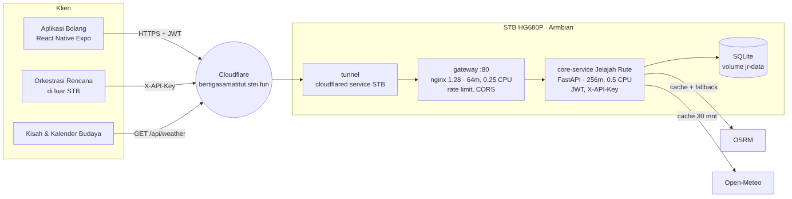

# Bolang · Microservice Jelajah Rute (TST)

Microservice di balik aplikasi Bolang: Penyusun itinerary wisata N hari di Bandung Raya. Layanan ini memperhitungkan jarak, waktu tempuh, jam buka, dan cuaca, dengan Katalog Tempat milik sendiri.

| | |
|---|---|
| Kelas | II3160 TST × II3140 PWAM, K01 |
| Tim | Muthia Ariesta Anggraeni (18224045, Backend TST) · Benedicta Sherin Chyntia Putri (18224065, Mobile PWAM) |
| URL layanan | `https://bertigasamatitut.stei.fun/api` |
| Dokumentasi interaktif | `https://bertigasamatitut.stei.fun/api/docs` (Swagger) · kontrak: `/api/openapi.json`, salinan di `docs/openapi.json` (root repo) |
| Cek hidup | `GET https://bertigasamatitut.stei.fun/api/health` |
| Versi | 1.1.0 |

Dokumen ini membahas microservice di folder `backend/` yang berjalan di STB. Gambaran proyek secara utuh ada di [README utama](../README.md), aplikasi mobile ada di [mobile/README.md](../mobile/README.md).

## 1. Arsitektur



STB HG680P (Armbian, arm64, RAM 2 GB) hanya menjalankan container microservice. Semua trafik publik masuk lewat Cloudflare Tunnel, jadi tidak ada port yang dibuka ke internet.

| Container | Image | Batas | Fungsi |
|---|---|---|---|
| gateway | `nginx:1.28-alpine`, port 80 | 64m, 0.25 CPU | Titik masuk tunggal, rate limit 60/menit per IP (pakai `CF-Connecting-IP`), CORS, batas body 64 KB |
| core-service | FastAPI (Python 3.12), arm64 | 256m, 0.5 CPU | Katalog Tempat, penjadwalan itinerary, template, adapter OSRM & Open-Meteo dengan cache, auth JWT dan X-API-Key |
| tunnel | `cloudflared` sebagai service systemd di STB | 64 MB (opsional lewat systemd) | Akses publik ke `https://bertigasamatitut.stei.fun`. Rute `/api/*` diarahkan ke `http://gateway:80` |
| database | SQLite di volume `jr-data` | ikut core | Tidak ada port database yang terbuka |

Semua container memakai `restart: unless-stopped` dan rotasi log `max-size: 10m, max-file: 3`. Rahasia disimpan di `.env` yang tidak di-commit.

Layanan inti tidak memanggil layanan tim lain. Data dari luar hanya OSRM (rute) dan Open-Meteo (cuaca). Keduanya memakai timeout 5 detik, retry 1 kali, lalu cache atau fallback. Kisah dan acara dari Kisah & Kalender Budaya serta kuliner dari Xplor Bandung digabungkan oleh Orkestrasi Rencana di luar STB.

## 2. Daftar endpoint

Base URL: `https://bertigasamatitut.stei.fun/api`. Lewat tunnel, hanya path berawalan `/api` yang diarahkan ke layanan ini. Path lain di domain yang sama mengarah ke aaPanel STB.

| Method & path | Auth | Fungsi |
|---|---|---|
| `GET /health` | Publik | Pemeriksaan kesehatan layanan |
| `POST /auth/register` | Publik | Daftar akun (peran `user`) |
| `POST /auth/login` | Publik | Masuk, menghasilkan JWT berumur 1 jam |
| `GET /auth/me` | JWT | Profil pemilik token |
| `GET /places?category&region_code&outdoor&page&limit` | Publik | Daftar Katalog Tempat. `region_code` cocok per awalan (`32.73` = semua kecamatan Kota Bandung) |
| `GET /places/{id}` | Publik | Detail tempat: koordinat, kode kecamatan, jam buka, lama kunjungan bawaan |
| `POST /places` | JWT admin | Tambah tempat. Koordinat, kode wilayah, kategori, jam buka ketujuh hari, dan `outdoor` wajib diisi |
| `POST /itineraries` | JWT | Buat itinerary dari `place_ids`, titik awal, tanggal mulai, jumlah hari, mode perjalanan |
| `GET /itineraries` | JWT | Daftar itinerary milik sendiri |
| `GET /itineraries/{id}` | JWT pemilik | Detail per hari: stop, waktu tiba, rute, cuaca, peringatan, daftar tidak terjadwal |
| `PATCH /itineraries/{id}` | JWT pemilik | Ubah urutan (`order`), kunci stop (`locked`), lama kunjungan (`visit_min`), status (`draft`/`selesai`) |
| `POST /itineraries/{id}/share` | JWT pemilik | Bagikan itinerary berstatus `selesai` sebagai template tanpa data pribadi |
| `GET /templates?place_id&days` | Publik | Daftar template |
| `POST /route/estimate` | Publik | Jarak & waktu tempuh antar dua titik (`driving` lewat OSRM, `walking` estimasi) |
| `GET /weather?lat&lon&date&end_date` | Publik | Prakiraan cuaca harian, hari ini sampai 15 hari ke depan (WIB). Dengan `end_date` hasilnya `{"days":[...]}`. Dipakai Kisah & Kalender Budaya |
| `POST /admin/api-keys` · `GET /admin/api-keys` · `DELETE /admin/api-keys/{id}` | JWT admin | Buat, lihat, dan cabut X-API-Key |

Format galat: `{"error":"KODE_ERROR","message":"..."}`. Format daftar: `{"data":[...],"page":1,"total":42}`.

| Status | Kode |
|---|---|
| 400 | `EMAIL_TAKEN`, `PLACE_EXISTS`, `NOT_FINISHED` |
| 401 | `UNAUTHORIZED`, `TOKEN_EXPIRED`, `INVALID_CREDENTIALS`, `INVALID_API_KEY` |
| 403 | `FORBIDDEN` (bukan admin, atau bukan pemilik itinerary) |
| 404 | `NOT_FOUND`, `PLACE_NOT_FOUND` |
| 422 | `VALIDATION_ERROR`, `INVALID_ORDER`, `DATE_OUT_OF_RANGE` |
| 429 | `RATE_LIMITED` |
| 503 | `UPSTREAM_UNAVAILABLE` (cuaca sedang tidak tersedia) |

## 3. Cara mendapat akses

| Siapa | Cara | Batas |
|---|---|---|
| Siapa pun (baca katalog, cuaca, rute, template) | Tanpa auth | 60 permintaan/menit per IP |
| Pengguna aplikasi | `Authorization: Bearer <JWT>` dari `POST /api/auth/login` | 60/menit per IP |
| Admin tim | JWT akun berperan `admin` (dibuat dari `ADMIN_EMAIL` di `.env`) | sama |
| Layanan kelompok lain (server ke server) | Header `X-API-Key: jr_...` | 60/menit per key |

Autentikasi dan otorisasi:

- **Password** di-hash dengan bcrypt. **JWT** HS256 berumur 1 jam, berisi `sub` (id pengguna) dan `role`.
- **Peran:** `user` bisa membuat dan mengelola itinerary sendiri. `admin` juga bisa menambah tempat dan mengelola API key.
- **Kepemilikan data:** `GET`, `PATCH`, dan `share` itinerary memeriksa `owner_id`. Pengguna lain mendapat `403 FORBIDDEN`.
- **X-API-Key** dibuat admin lewat `POST /api/admin/api-keys`. Nilainya hanya ditampilkan sekali, disimpan sebagai hash SHA-256, dan bisa dicabut. Setiap pemakaian dicatat di log (`api_client=<nama>`) dan `last_used_at`. Key tidak boleh dimasukkan ke APK.
- Untuk meminta API key, hubungi tim Jelajah Rute (Muthia, 18224045) dengan menyebut nama layanan dan endpoint yang dipakai. Key dikirim lewat pesan pribadi.

**Akun demo (peran user):** `demo@bolang.id` / `bolang2026`

## 4. Contoh request

```bash
BASE=https://bertigasamatitut.stei.fun/api

# Cek layanan
curl $BASE/health
# {"status":"ok","service":"bolang","version":"1.1.0"}

# Katalog: tempat ruang tertutup di Kota Bandung
curl "$BASE/places?outdoor=false&region_code=32.73"

# Login akun demo, simpan token
TOKEN=$(curl -s -X POST $BASE/auth/login -H "Content-Type: application/json" \
  -d '{"email":"demo@bolang.id","password":"bolang2026"}' | python3 -c "import sys,json;print(json.load(sys.stdin)['token'])")

# Buat itinerary 2 hari
curl -X POST $BASE/itineraries -H "Authorization: Bearer $TOKEN" -H "Content-Type: application/json" -d '{
  "place_ids": ["tangkuban-parahu","orchid-forest-cikole","curug-dago","museum-geologi","trans-studio-bandung"],
  "start_point": {"lat": -6.9218, "lon": 107.6071},
  "start_date": "2026-11-28", "days": 2, "travel_mode": "driving"
}'

# Kunci stop pertama lalu hitung ulang, atau tandai selesai
curl -X PATCH $BASE/itineraries/<id> -H "Authorization: Bearer $TOKEN" \
  -H "Content-Type: application/json" -d '{"locked": ["museum-geologi"]}'
curl -X PATCH $BASE/itineraries/<id> -H "Authorization: Bearer $TOKEN" \
  -H "Content-Type: application/json" -d '{"status": "selesai"}'

# Cuaca (contoh pemanggilan server ke server dengan API key)
curl -H "X-API-Key: jr_xxxxxxxx" "$BASE/weather?lat=-6.9211&lon=107.6094&date=2026-11-28"
# {"lat":-6.9211,"lon":107.6094,"date":"2026-11-28","precipitation_probability":80,"precipitation_mm":12.4,
#  "temp_min":19.5,"temp_max":27.1,"weather_code":63,"fetched_at":"2026-11-22T14:00:00+07:00","source":"open-meteo"}
# (angka di atas contoh bentuk respons, bukan prakiraan sungguhan)

# Rentang beberapa hari
curl "$BASE/weather?lat=-6.9211&lon=107.6094&date=2026-11-28&end_date=2026-11-30"
# {"days":[{...2026-11-28...},{...2026-11-29...},{...2026-11-30...}]}

# Estimasi rute
curl -X POST $BASE/route/estimate -H "Content-Type: application/json" \
  -d '{"from":{"lat":-6.8656,"lon":107.6156},"to":{"lat":-6.9255,"lon":107.6337}}'
```

Potongan respons `POST /itineraries` (hari pertama, saat OSRM tidak terjangkau sehingga `source` = `estimate`; nilai cuaca hanya ilustrasi):

```json
{
  "id": "3f9c1a2b7d4e", "status": "draft", "start_date": "2026-11-28", "days": 2,
  "needs_refresh": false,
  "day_plans": [{
    "date": "2026-11-28",
    "weather": {"date": "2026-11-28", "precipitation_probability": 80, "temp_max": 27.1, "source": "open-meteo"},
    "stops": [{"place_snapshot": {"id": "museum-geologi", "name": "Museum Geologi"},
               "arrival_time": "08:07", "start_time": "09:00", "departure_time": "10:30",
               "wait_min": 53, "visit_min": 90, "locked": false}],
    "legs": [{"from": "start", "to": "museum-geologi", "distance_m": 3679, "duration_s": 441, "source": "estimate"}],
    "warnings": [{"code": "RAIN_RISK", "place_id": "curug-dago",
                  "message": "Peluang hujan 80% di tempat ruang terbuka.",
                  "alternatives": [{"place_id": "museum-geologi", "name": "Museum Geologi", "distance_km": 4.0}]}]
  }],
  "unscheduled": []
}
```

## 5. Integrasi dengan layanan lain

**Kisah & Kalender Budaya memakai `/weather` kami** (kontrak 22 November 2026, kontak: Rafi Putra Nugraha 18224079, Illona Nasywa Hannum 18224081).

| Butir | Kesepakatan |
|---|---|
| Path | `GET https://bertigasamatitut.stei.fun/api/weather` |
| Field wajib | `date`, `precipitation_probability` (integer 0 sampai 100), `fetched_at` (ISO 8601, WIB) |
| Field tambahan | `precipitation_mm`, `temp_min`, `temp_max`, `weather_code` (kode WMO), `source` (`open-meteo` atau `cache`) |
| Rentang | `end_date` didukung, hasil `{"days":[...]}` |
| Auth | Publik. X-API-Key opsional untuk layanan integrasi mereka, kuota 60/menit per key |
| Galat | 422 `DATE_OUT_OF_RANGE` (lewat atau lebih dari 15 hari ke depan), 422 parameter tidak valid, 503 Open-Meteo mati tanpa cache, 429 terlalu banyak permintaan |
| Ambang hujan | 70% atau lebih, sama dengan `RAIN_RISK` |

**Yang dipakai Orkestrasi Rencana dari Kisah & Kalender Budaya** (di luar STB, tidak dipanggil layanan inti): `GET /api/stories/summaries?region_codes=` memakai `region_code` kecamatan dari Katalog Tempat, dan `GET /api/events?region_code&from&to` untuk acara di tanggal perjalanan. Galat mereka berformat `{"detail": "..."}`, respons di-cache minimal 5 menit. Kuliner terdekat diambil dari Xplor Bandung.

## 6. Aturan penjadwalan

1. Urutan dimulai dari tempat terdekat dengan titik awal (nearest neighbor). Stop yang dikunci tidak dipindahkan saat dihitung ulang.
2. Satu hari maksimal 10 jam secara bawaan (`max_hours`, paling lama 12). Tempat yang tidak muat pindah ke hari berikutnya.
3. Kunjungan harus berada di dalam jam buka. Kalau datang sebelum buka, stop menunggu (`wait_min`). Tempat yang tidak muat di hari mana pun masuk `unscheduled` beserta alasannya (`CLOSED_ON_DAY`, `OUTSIDE_OPENING_HOURS`, `DAY_LIMIT_EXCEEDED`).
4. Peluang hujan 70% atau lebih di hari yang berisi tempat ruang terbuka memicu `RAIN_RISK`, dengan usulan tempat ruang tertutup dalam radius 10 km.
5. Itinerary menyimpan `place_snapshot`. Kalau data tempat berubah, `needs_refresh` bernilai `true`.
6. Kalau OSRM tidak bisa dihubungi, jarak dihitung dari garis lurus × 1,3 dengan kecepatan rata-rata 30 km/jam (`"source":"estimate"`).

## 7. Menjalankan

Di STB (Armbian), dari folder repo:

```bash
cd backend
cp .env.example .env          # isi JWT_SECRET (openssl rand -hex 32), ADMIN_*, DEMO_PASSWORD
docker compose build core-service
docker compose up -d          # gateway di port 80, core-service di jaringan internal
curl localhost/api/health     # {"status":"ok","service":"bolang",...}
docker stats --no-stream      # Bolang memakai sekitar 50 MB (batas total 500 MB)
```

Cloudflare Tunnel berjalan sebagai service di STB, bukan sebagai container:

```bash
apt-get install -y cloudflared            # dari repo pkg.cloudflare.com
mkdir -p /etc/cloudflared
printf '%s' '<TOKEN_TUNNEL>' > /etc/cloudflared/token && chmod 600 /etc/cloudflared/token
cloudflared service install <TOKEN_TUNNEL>
echo "127.0.0.1 gateway" >> /etc/hosts    # nama gateway di rute tunnel = port 80 STB
systemctl status cloudflared              # active (running)
```

Rute di dashboard Cloudflare:

| Hostname dan path | Service |
|---|---|
| `bertigasamatitut.stei.fun` path `^/api(/.*)?$` | `http://gateway:80` (layanan Bolang) |
| `bertigasamatitut.stei.fun` | `https://localhost:1122` (aaPanel) |

Sebagai alternatif, tunnel bisa dijalankan sebagai container di compose: isi `TUNNEL_TOKEN` di `.env`, lalu `docker compose --profile tunnel up -d`.

Image juga bisa dibangun di laptop untuk arm64, lalu dibawa ke STB:

```bash
docker buildx build --platform linux/arm64 -t bolang-core:1.1 --load backend
docker save bolang-core:1.1 | gzip > core.tar.gz   # salin ke STB, lalu: docker load < core.tar.gz
```

Backup harian SQLite: `sh scripts/backup-db.sh` (dari folder `backend`) (pasang di crontab, menyimpan 7 salinan terakhir).

Tes otomatis:

```bash
pip install -r requirements-dev.txt && pytest
```